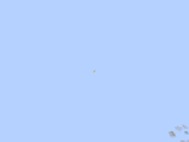
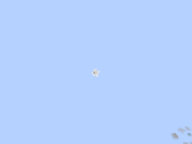
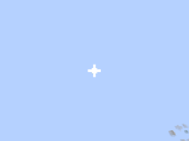
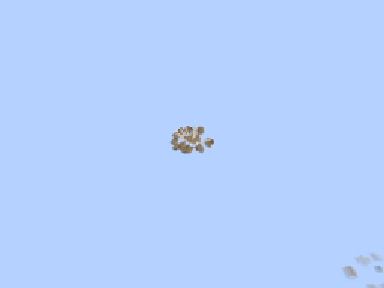
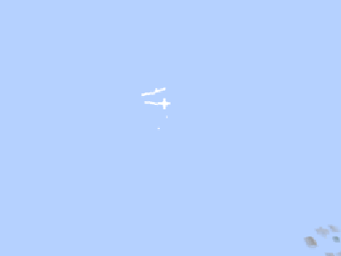
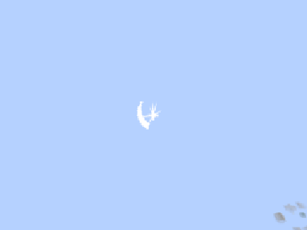
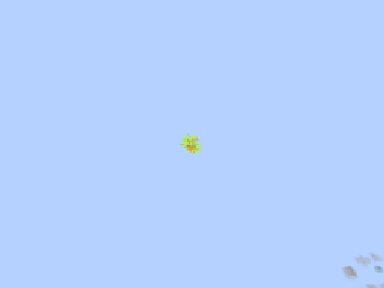
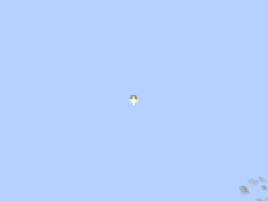
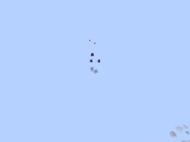
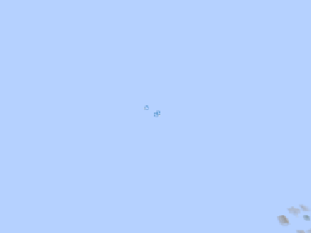

# MinecraftFx

An open source library of 300 Minecraft visual effects and matching sounds, organized as JSON files in 15 categories. A shared NeoForge mod plays the effects using [Lodestone](https://github.com/LodestarMC/Lodestone) particles. Each effect can be scaled, recolored, and oriented without duplicating its definition.

The database is the versioned collection under [`src/main/resources/assets/minecraftfx/`](src/main/resources/assets/minecraftfx/). No database server or external service is required. The Java runtime, textures, audio, and authoring tools are included so contributors can use and extend the collection.

## Visual demonstrations

Ten looping GIF previews from the project's early in-game captures. Each cycles through three captured moments at ticks 3, 9, and 18, with a pause before repeating; these are sampled previews, not full-motion recordings. They show earlier captures and may differ from later revisions. GIFs have no audio; use `/fx play` to hear the matching sounds.

| Flame jet | Feather burst |
| --- | --- |
|  |  |
| `minecraftfx:fire/flame_jet` | `minecraftfx:holy/feather_burst` |

| Ice shatter | Ground slam |
| --- | --- |
|  |  |
| `minecraftfx:ice/ice_shatter` | `minecraftfx:impact/ground_slam` |

| Electrified | Slash |
| --- | --- |
|  |  |
| `minecraftfx:lightning/electrified` | `minecraftfx:melee/slash` |

| Leaf storm | Confetti |
| --- | --- |
|  |  |
| `minecraftfx:nature/leaf_storm` | `minecraftfx:pickup/confetti` |

| Curse | Bubbles |
| --- | --- |
|  |  |
| `minecraftfx:shadow/curse` | `minecraftfx:water/bubbles` |

## Browse the database

| Category | Definitions |
| --- | --- |
| Arcane | [arcane](src/main/resources/assets/minecraftfx/fx/arcane/) |
| Explosion | [explosion](src/main/resources/assets/minecraftfx/fx/explosion/) |
| Fire | [fire](src/main/resources/assets/minecraftfx/fx/fire/) |
| Holy | [holy](src/main/resources/assets/minecraftfx/fx/holy/) |
| Ice | [ice](src/main/resources/assets/minecraftfx/fx/ice/) |
| Impact | [impact](src/main/resources/assets/minecraftfx/fx/impact/) |
| Lightning | [lightning](src/main/resources/assets/minecraftfx/fx/lightning/) |
| Melee | [melee](src/main/resources/assets/minecraftfx/fx/melee/) |
| Nature | [nature](src/main/resources/assets/minecraftfx/fx/nature/) |
| Pickup | [pickup](src/main/resources/assets/minecraftfx/fx/pickup/) |
| Science fiction | [sci_fi](src/main/resources/assets/minecraftfx/fx/sci_fi/) |
| Shadow | [shadow](src/main/resources/assets/minecraftfx/fx/shadow/) |
| Spawn | [spawn](src/main/resources/assets/minecraftfx/fx/spawn/) |
| Status | [status](src/main/resources/assets/minecraftfx/fx/status/) |
| Water | [water](src/main/resources/assets/minecraftfx/fx/water/) |

Each category contains 20 effects. IDs use `minecraftfx:<category>/<name>`, such as `minecraftfx:impact/critical_spark`. Browse the [sound catalog](docs/SOUND_LIBRARY.md) for the 300 matching sounds.

## Build and try

Requires a JDK 21 installation. The Gradle wrapper downloads the pinned build dependencies on the first run. Targets Minecraft **1.21.1**, NeoForge **21.1.265**, and Lodestone **1.8.2** (Modrinth version `CohX6yP1`).

```sh
git clone https://github.com/spencertamashiro/MinecraftFx.git
cd MinecraftFx
./gradlew build
./gradlew runClient
```

On Windows, use `gradlew.bat build` and `gradlew.bat runClient`. Build output is in `build/libs/`. Install the mod with NeoForge and Lodestone on both the client and server; Lodestone is a separate dependency and is not bundled into the mod JAR.

Create a world with cheats enabled:

```mcfunction
/fx play minecraftfx:impact/critical_spark
/fx play minecraftfx:fire/fire_ring ~ ~ ~
/fx play minecraftfx:ice/frost_nova ~ ~ ~ 0.5 tint=#33AAFF
/fx play minecraftfx:arcane/arcane_missile ~ ~1 ~ 1 facing=look
/fx play minecraftfx:impact/critical_spark ~ ~ ~40 1 force=true
/fx visual minecraftfx:fire/meteor_strike ~ ~ ~5
/fx sound minecraftfx:fire/meteor_strike
```

Syntax: `/fx play|visual|sound <effect> [<pos> [<scale> [<options>]]]`. Scale ranges from 0.1 to 10. Options can appear in any order:

| Option | Values |
| --- | --- |
| `tint=` | `#RRGGBB` or a Minecraft color name; a bare color also works |
| `facing=` | `me`, `look`, `up`, `down`, compass direction, or `yaw,pitch`; defaults to `me` |
| `up=` | Same direction values; defaults to world up |
| `volume=` | 0 to 10 |
| `pitch=` | 0.5 to 2 |
| `force=` | `true` or `false` (default); bypasses the camera's 32-block particle cutoff and the player's reduced particle setting |

Play requests are sent to players within 96 blocks. With `force=false`, vanilla still skips particles beyond 32 blocks from the camera and reduces them according to the player's Particles setting. `force=true` allows those particles to appear within the send radius; sound keeps its own audible range. In Java, use `FxOptions.withForce(true)` for the same behavior.

The force option updates the network protocol to version 4. Update both clients and servers together.

Ground effects work best at the player's feet. Projectiles travel along their facing direction. Status effects are one-shot bursts; repeat them from your own gameplay code for persistent statuses.

From another mod, on the server:

```java
MinecraftFx.play(serverLevel, ResourceLocation.parse("minecraftfx:impact/critical_spark"), hitPos, towardsAttacker);
MinecraftFx.play(serverLevel, effectId, pos,
        FxOptions.facing(normal).withScale(2).withTint(0x33AAFF).withVolume(0.5f));
```

The API classes are in `dev.minecraftfx`. The server sends a play request to nearby clients; clients load and render the effect resources.

## Effect format and contributions

An effect combines a palette, particle layers, and optional sound cues:

```json
{
  "sounds": [{ "id": "minecraftfx:impact.hit_flash" }],
  "palette": { "core": "#FFFFFF", "hot": "#FFE98A" },
  "layers": [{
    "sprite": "minecraftfx:flash",
    "lifetime": [4],
    "scale": { "from": 0.25, "to": 1.0 },
    "color": ["core", "hot"]
  }]
}
```

Layer fields support shapes, emission patterns, delays, repetition, motion, gravity, orbits, and curves. See [`Layer.java`](src/main/java/dev/minecraftfx/client/Layer.java) for the field codecs and [`EffectDefinition.java`](src/main/java/dev/minecraftfx/client/EffectDefinition.java) for validation. Existing effects provide complete examples. Each particle sheet is defined in `particles/`, with frames in `textures/particle/`.

1. Add `fx/<category>/<name>.json` under the assets directory. Existing sprite sheets require no new Java code.
2. Add a matching sound recipe and regenerate its assets as described in [the sound authoring guide](docs/SOUNDS.md#add-a-sound-for-a-new-effect).
3. Update the catalog counts asserted in [`EffectDefinitionTest.java`](src/test/java/dev/minecraftfx/client/EffectDefinitionTest.java) when expanding the collection. Tests also reject duplicate layer lists, missing assets, and generic explosion patterns outside impact/explosion.
4. Run `./gradlew build`, then preview the effect in game. After editing resources, run `./gradlew processResources` and press F3+T to reload.

To add a sprite, extend `tools/make_sprites.ps1`, run it with PowerShell, and register the sheet in `MinecraftFx.SPRITE_SHEETS`. To regenerate sounds, install `tools/requirements-sounds.txt` in a Python environment and run `python tools/make_sounds.py`. Python packages are only needed to regenerate audio; checked-in assets support normal builds without them.

## Project layout

```text
src/main/resources/assets/minecraftfx/
  fx/<category>/*.json       Effect definitions
  particles/*.json          Sprite frame lists
  textures/particle/*.png    Original grayscale frames, tinted at runtime
  sounds/<category>/*.ogg    Mono 44.1 kHz audio
  sounds.json               Sound event definitions
  lang/en_us.json            Sound subtitles
src/main/java/dev/minecraftfx/  Shared runtime and client renderer
src/test/java/dev/minecraftfx/  Catalog, codec, command, and packet tests
tools/                        Sprite generator, sound synthesizer, and recipes
docs/                         Sound usage, catalog, and ten GIF previews
```

## Status and validation

This is a proof of concept. On November 10, 2026, `gradlew.bat --offline clean build` passed with 42 tests and no failures in the publication checkout, including audio decoding and resource references. The source project's earlier checks report all 300 effects loading in game. Only the first 51 effects were visually inspected in earlier versions, and no sounds have been reviewed by ear. Later effect revisions, remote multiplayer, compatibility with other rendering mods, and performance under heavy load still need playtesting. Build success does not establish visual or audio quality.

Run `./gradlew test` to validate the collection and runtime behavior covered by the tests. Contributions should state which effects were previewed or listened to.

## License and attribution

Original MinecraftFx code, effect definitions, textures, sound recipes, synthesized audio, and documentation are provided under the [MIT License](LICENSE). Third-party dependencies retain their own licenses; the Gradle wrapper is covered by [Apache-2.0](gradle/wrapper/LICENSE). The GIFs depict Minecraft gameplay with this mod. Minecraft is required separately and is not included. This project is not affiliated with Mojang or Microsoft.

Lodestone is linked as an external mod. The source project's dependency notes record an LGPL-3.0 declaration on its project pages and a `GPLv3` declaration inside the 1.8.2 JAR; the MIT license here applies to MinecraftFx's original work and does not relicense Lodestone.

The category/effect naming model was inspired by [patch-gg/pixelfx](https://github.com/patch-gg/pixelfx). No code or art from that project is included. Sprites are drawn by `tools/make_sprites.ps1`; sounds are synthesized from recipes without recorded samples.
